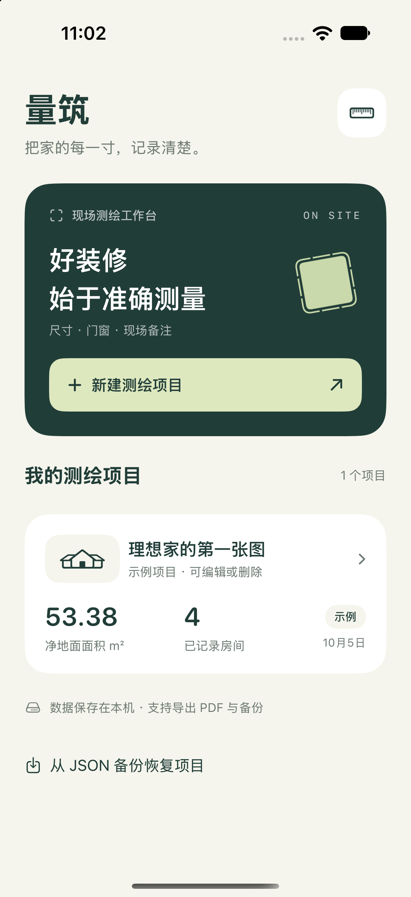
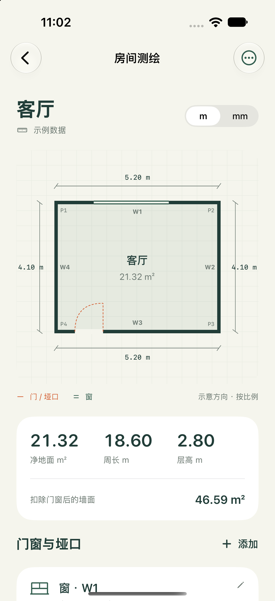

# 量筑 · 装修现场测绘 App

原生 SwiftUI iPhone / iPad App，面向装修现场的房间、门窗和尺寸记录。最低 iOS 17，无第三方库，无需后端。

## 界面预览

 

## 在 Xcode 运行

1. 打开 `LiangZhu.xcodeproj`。
2. 选择 `LiangZhu` scheme，以及一个 iPhone 或 iPad 模拟器。
3. 按 **⌘R** 运行。首页的项目明确标注为示例，可直接查看图纸，也可新建自己的项目。
4. 真机运行时，在 **Signing & Capabilities** 中选择你的开发团队；如有 bundle ID 冲突，修改 `com.liangzhu.survey`。

工程已在本机 Xcode 27.0、iOS 27.0 模拟器上编译并运行，16 项 XCTest 通过；iOS 真机目标也已通过无签名编译。LiDAR 的真实精度与扫描流程仍需在支持设备上验证。

## 已实现

- 项目新建、编辑、删除；多房间管理。
- 矩形、L 形和自定义多边形；录入内净尺寸、层高、现场备注。
- 按比例生成平面图，标注每面墙的长度、W 墙号与 P 顶点号。
- 门、窗、垭口：墙面、距起点墙角距离、宽高、窗台离地高度。
- 检查轮廓自交、重复点、无效数字、门窗越界、超层高和重叠。
- 地面面积、周长、扣除门窗后的净墙面面积；图纸米 / 毫米切换。
- 本机 JSON 原子保存，重启保留；读取异常时保留原文件并停止写入。
- 多页 PDF 测绘记录；JSON 备份导出与恢复，恢复生成新项目，不覆盖原项目。
- RoomPlan LiDAR 扫描入口：相机授权、设备检查、扫描结果转平面轮廓与门窗记录。

## 使用口径与当前范围

输入尺寸统一用米。图纸的 W1 对应 P1→P2，W2 对应 P2→P3，依此类推；距墙角沿墙面起点计量。图纸顶部是示意方向，不代表正北。

净地面面积按多边形计算；净墙面面积 = 周长 × 层高 − 门、窗、垭口面积。不含墙体面积、梁柱、材料损耗或踢脚线，面积统计不是装修报价。

每个房间单独出图，尚无整屋拼接、照片标注、云同步或 CAD / DXF 导出。自定义轮廓支持 3–30 个顶点，坐标绝对值 ≤ 100 m；规则房间宽深 0.1–100 m，层高 1–20 m。

扫描使用苹果 [RoomPlan](https://developer.apple.com/augmented-reality/roomplan/)，需要支持 RoomPlan 的 LiDAR 设备，模拟器不支持真实扫描。地面 [polygonCorners](https://developer.apple.com/documentation/roomplan/capturedroom/surface/polygoncorners) 按局部坐标转换到世界坐标后投影到平面。一次记录一个房间；多块地面或弧形墙会提示改用手动记录。无法可靠匹配的门窗会在备注中明确列出遗漏数量。关键施工尺寸需现场复核。

## 源码

| 位置 | 用途 |
| --- | --- |
| `LiangZhu/Models/SurveyModels.swift` | 数据模型、面积、轮廓与门窗校验 |
| `LiangZhu/Views/` | 项目界面、尺寸表单、平面图 |
| `LiangZhu/Services/ProjectStore.swift` | 本地保存与备份恢复 |
| `LiangZhu/Services/SurveyExporter.swift` | PDF 与 JSON 导出 |
| `LiangZhu/Services/RoomScan.swift` | RoomPlan 扫描与坐标转换 |
| `LiangZhuTests/SurveyTests.swift` | 16 项几何、存储和导出测试 |

本地数据在 App 沙盒 `Library/Application Support/LiangZhu/projects-v1.json`，卸载 App 会删除沙盒数据，重要项目请导出备份。导出通过系统分享面板，可保存到“文件” App。

## 命令行验证

```sh
xcodebuild -project LiangZhu.xcodeproj -scheme LiangZhu \
  -destination 'platform=iOS Simulator,name=iPhone 18 Pro' \
  -derivedDataPath build CODE_SIGNING_ALLOWED=NO test
```

添加新的 Swift 文件后可在 Xcode 中加入 target，或运行 `python3 scripts/generate_project.py` 重建工程引用。该脚本会重写工程文件及 scheme；已在 Xcode 中调整签名或 build settings 后，请优先在 Xcode 管理文件，避免覆盖你的配置。

## 开源许可

本项目采用 [MIT 许可证](LICENSE)，允许使用、修改、分发及商业使用，请保留版权与许可证声明。
